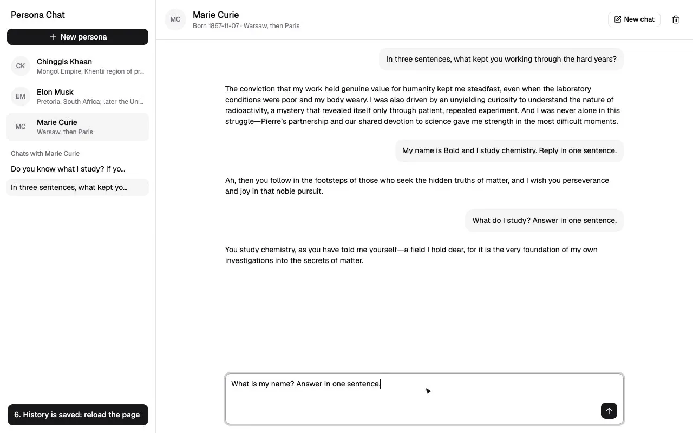

# Persona Chat

Chat with famous people. Pick a persona, or create your own, and it replies in character. Replies appear live, word by word.



**[Watch the demo video](docs/demo.mp4)** (1:43)

## What it does

- **Personas:** create, list and delete them. Chinggis Khaan and Elon Musk are included.
- **Live chat:** the persona answers in its own voice, and you can stop a reply at any time.
- **Chat history:** chats are saved, so you can reopen them after a reload.
- **New chat:** starts clean, with nothing from your earlier chats.

## What you need

- [uv](https://docs.astral.sh/uv/getting-started/installation/) to run the backend
- [Bun](https://bun.sh) to run the frontend
- A [Vercel AI Gateway](https://vercel.com/docs/ai-gateway) API key. The free credits are enough.

## Start the app

**1. Get the code**

```bash
git clone https://github.com/enkhbayarz/ddam.git
cd ddam
```

**2. Add your API key**

```bash
cp backend/.env.example backend/.env
```

Open `backend/.env` and paste your key after `AI_GATEWAY_API_KEY=`.

**3. Start the backend** in one terminal

```bash
cd backend
uv run fastapi dev app/main.py
```

**4. Start the frontend** in a second terminal

```bash
cd frontend
bun install
bun run dev
```

**5. Open the app** at http://localhost:5173

The API docs are at http://localhost:8000/docs.

## How it is built

| Part | Tools |
| --- | --- |
| Backend | Python, FastAPI, Pydantic |
| Frontend | Vite, React, Tailwind CSS, shadcn/ui |
| Chat UI | AI SDK `useChat`, Streamdown |
| AI model | DeepSeek V4 Flash through Vercel AI Gateway |
| Storage | Local JSON files in `backend/data/` |

## Where things are

```
backend/app/
├── api/           routes
├── schemas/       request validation
├── services/      persona prompt and streaming
├── repositories/  saving to JSON files
└── core/          settings, errors, middleware, CORS

frontend/src/
├── components/    the UI
├── hooks/         loading personas and chats
└── lib/           API client and chat setup
```

## Run the tests

```bash
cd backend
uv run pytest
```
